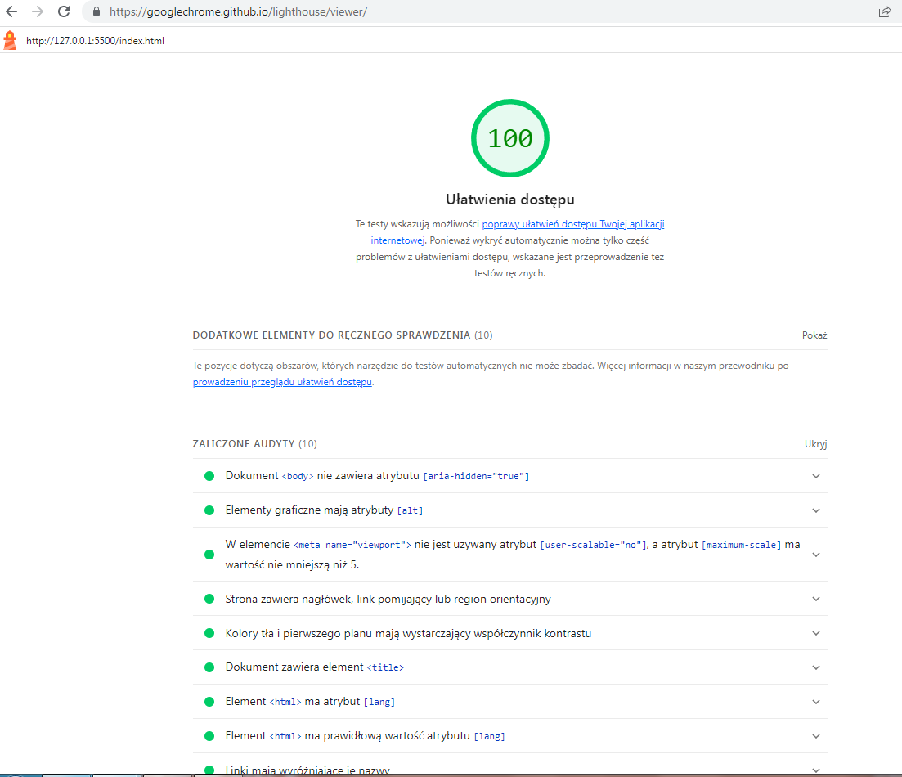

# Wrzosowisko — szkółka jeździecka i stadnina koni
Projekt strony internetowej fikcyjnej szkółki jeździeckiej i stadniny koni „Wrzosowisko”.
## Technologie
- HTML5
- CSS3
- JavaScript
- Git
- GitHub
- AI (~ ChatGPT)- jako pomoc w planowaniu struktury strony, przygotowywaniu przykładowych tekstów, doborze kolorystyki, tworzeniu i wyjaśnianiu fragmentów CSS oraz konsultowaniu poprawek dostępności i responsywności.

## Planowane strony

### Publiczne
- Strona główna
- Nasze konie
- Oferta
- O stadninie
- Kontakt

### Użytkownik
- Logowanie
- Profil użytkownika

### Administracja
- Panel administracyjny
- Ogłoszenia
- Użytkownicy
- Statystyki

## Funkcjonalności JavaScript
Planowane funkcjonalności:
- walidacja formularza,
- komunikaty o błędach,
- filtrowanie koni,
- interaktywny element poza formularzem.

## Dostępność i responsywność
W aktualnej wersji projektu uwzględniono:
- semantyczny HTML,
- opisy alternatywne zdjęć,
- widoczny wskaźnik fokusu,
- obsługę klawiaturą,
- odpowiedni kontrast tekstu i tła,
- dostosowanie układu strony do różnych szerokości ekranów,
- wykorzystanie CSS Grid i Flexbox.

### Audyt dostępności — Lighthouse
Aktualna wersja strony została sprawdzona za pomocą narzędzia Lighthouse
w kategorii Accessibility (Ułatwienia dostępu).

Uzyskany wynik: **100/100 punktów**.

### Testy responsywności

Strona została sprawdzona przy szerokościach:
- 320 px <=> 1920px ;

Podczas testów poprawiono układ nagłówka, menu, kart koni oraz sekcji kontaktowej na mniejszych ekranach.

## Status
Projekt jest w trakcie tworzenia.

### Obecnie przygotowałam:
- podstawową strukturę projektu,
- sekcję : „O nas”,
- sekcję : „Nasze konie” z przykładowymi postaciami koni i zdjęciami,
- sekcję : „Oferta”, 
- sekcję : „Kontakt”,
- nawigację z rozwijanymi elementami,
- podstawowe style CSS,
- układ kart dla koni i oferty,
- układ bloków w sekcji kontaktowej,
- Uporządkowanie i uproszczenie kodu CSS.
- poprawienie responsywności strony,
- dostosowanie strony do urządzeń mobilnych i większych ekranów,
- audyt dostępności Lighthouse z wynikiem 100/100 punktów.

Kolejne etapy projektu obejmują:
- utworzenie formularza kontaktowego,
- dodanie walidacji formularza za pomocą JavaScript,
- dodanie interaktywnych elementów strony,
- dalsze poprawki dostępności i responsywności.